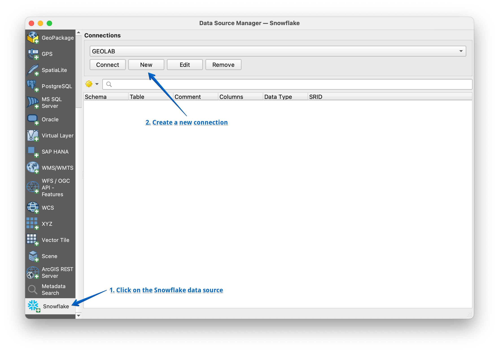
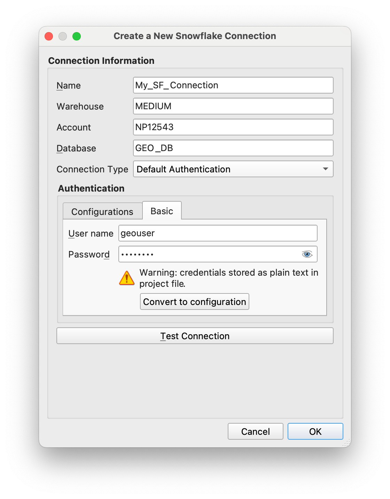
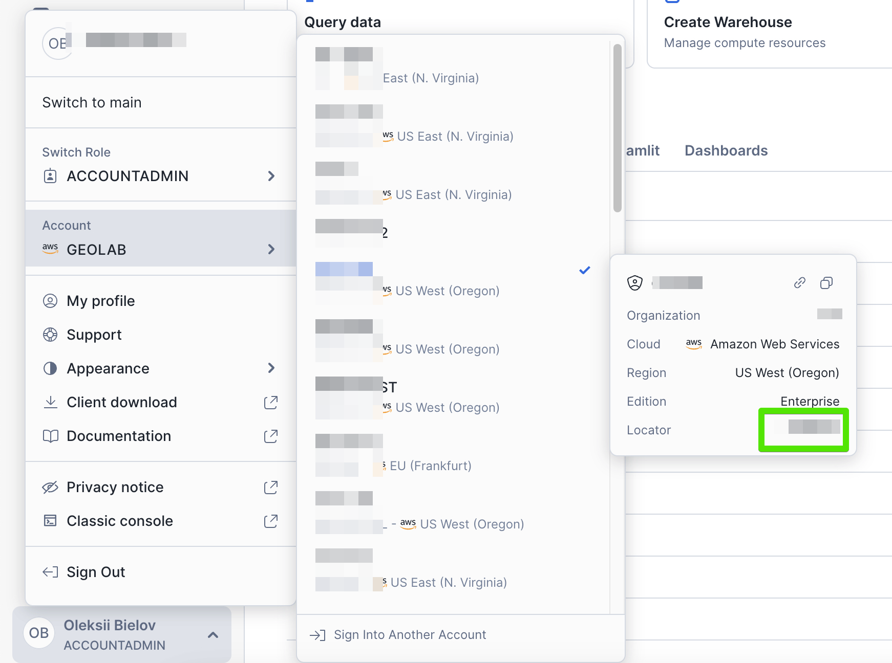
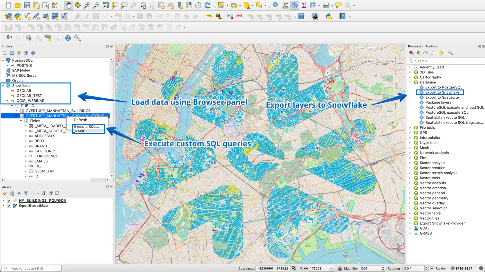

# Snowflake Connector for QGIS

## Introduction
This package includes the Snowflake Connector for QGIS.

The Snowflake Connector for QGIS provides an interface for open-source GIS application QGIS that can connect to Snowflake and perform all standard operations. It provides a connection via [Python connector](https://github.com/snowflakedb/snowflake-connector-python).

## Installation
The plugin can be installed using the QGIS plugin manager. 
- Go to `Plugins` > `All`, search for `Snowflake Connector for QGIS` and click `Install Plugin`.

You can try latest development versions by downloading and installing the plugin in QGIS from a zip file. These are available [here](https://github.com/snowflakedb/qgis-snowflake-connector/releases), download the zip-file "qgis-snowflake-connector.zip" for the release you want to try.

> **Upgrading an existing installation:** after updating the plugin to a new version, fully restart QGIS. QGIS registers the Snowflake vector data provider once per session and cannot replace it while running, so a running session keeps using the previously loaded provider code until QGIS is restarted. The plugin logs a warning in the `Snowflake Plugin` message log when a restart is required to finish an upgrade.

## Getting Started
1. Install the plugin with the QGIS plugin manager.

2. Go to Layer > Data Source Manager. In the list of data sources click on Snowflake and create a new connectionn

3. Add connection details and choose Connection type (default or SSO)

You can get your account locator here:

Note: Sometimes, the account locator would look like locator.region.azure. For example snowflake.west-europe.azure or abc12345.us-east-1.

4. Use standard features for reading/writing geospatial data

## Support
If you found bugs or have suggestions for improving the plugin, please [submit](https://github.com/snowflakedb/qgis-snowflake-connector/issues) the issue or contribute by creating a pull request.

Snowflake Documentation is available at:
https://docs.snowflake.com/