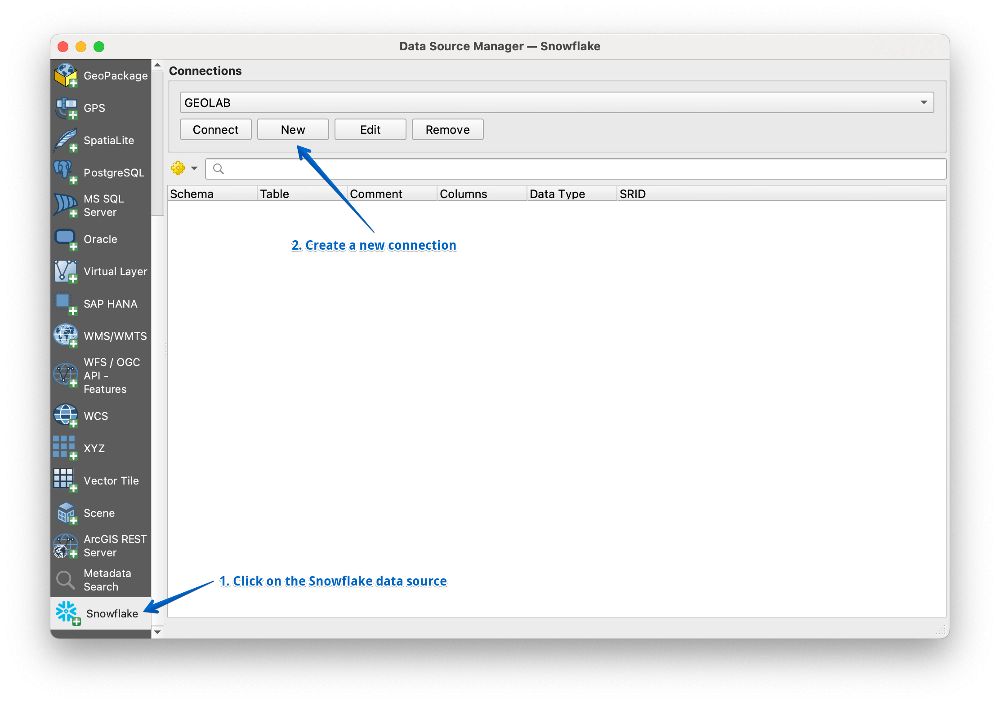
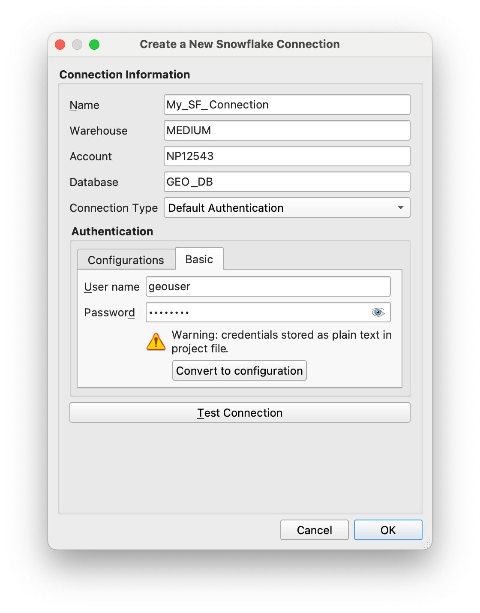
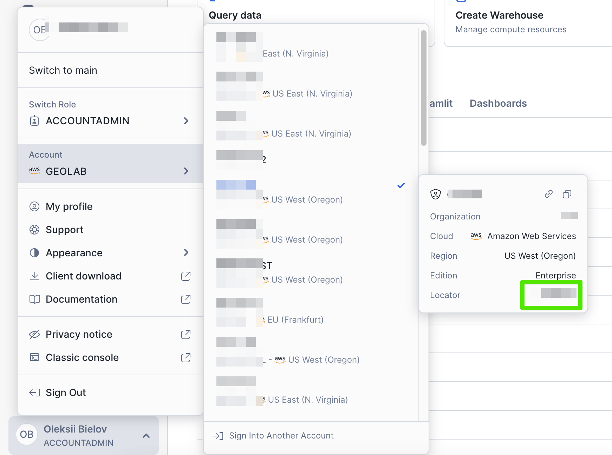
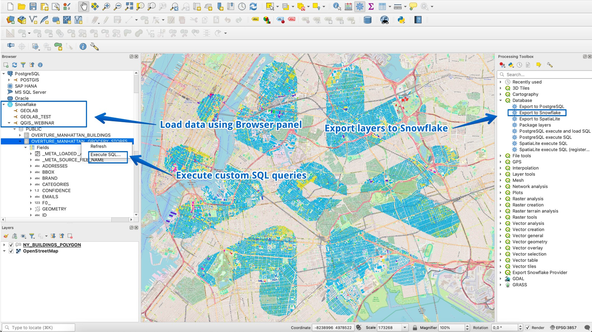

# Snowflake Connector for QGIS

## Introduction
This package includes the Snowflake Connector for QGIS.

The Snowflake Connector for QGIS provides an interface for open-source GIS application QGIS that can connect to Snowflake and perform all standard operations. It provides a connection via [Python connector](https://github.com/snowflakedb/snowflake-connector-python).

## Installation
The plugin can be installed using the QGIS plugin manager.
- Go to `Plugins` > `All`, search for `Snowflake Connector for QGIS` and click `Install Plugin`.

For a tagged release ZIP (built by CI, not GitHub’s auto source archive), open [Releases](https://github.com/snowflakedb/qgis-snowflake-connector/releases), download **qgis-snowflake-connector.zip**, then use **Plugins → Install from ZIP**.

> **Upgrading an existing installation:** after updating the plugin to a new version, fully restart QGIS. QGIS registers the Snowflake vector data provider once per session and cannot replace it while running, so a running session keeps using the previously loaded provider code until QGIS is restarted. The plugin logs a warning in the `Snowflake Plugin` message log when a restart is required to finish an upgrade.

## Connect
1. Install the plugin (see above).
2. Go to **Layer → Data Source Manager**, choose **Snowflake**, and create a connection.

3. Add connection details and choose Connection type (default or SSO).

You can get your account locator here:

Note: Sometimes, the account locator would look like locator.region.azure. For example snowflake.west-europe.azure or abc12345.us-east-1.

## Load a table
In the Browser (or Data Source Manager), open your connection, expand a schema, and double-click a spatial table to add it as a Snowflake layer. After load, the map zooms to the layer extent when it is available.

A **Snowflake** toolbar (and **Plugins → Snowflake**) also provides Execute SQL, Reload from Snowflake, map-extent toggle, Ask Snowflake, and Map brief.

## Large tables (map-extent loading)
For tables too large to sample wholesale, right-click a spatial table in the Browser and choose **Add with map-extent loading**. The layer URI includes `extent_mode=1`. Each map render issues a query filtered to the current canvas rectangle with a per-request row LIMIT. Results are capped, so a dense view may show a truncated subset; selection and feature ids are per query and these layers are read-only. Warehouse cost still depends on clustering and pruning—`ADD SEARCH OPTIMIZATION ON GEO(<geom_column>)` helps. You can also toggle this mode from the toolbar for an existing Snowflake layer.

## One-shot spatial filter
For a filtered download (not live map-extent loading), right-click a spatial table and choose **Download with spatial filter…**. Set the extent from the current map canvas, another project layer, or by drawing a rectangle; optionally add a WHERE clause and a row limit. The dialog previews the `ST_INTERSECTS` SQL. On OK the plugin loads the SQL as a Snowflake query layer in the background, reports progress and cancel/empty/failure in the message bar, and zooms to the new layer.

## Attribute-only tables
Tables without a GEOGRAPHY/GEOMETRY/H3 column appear under **Tables (no geometry)** in the Browser. Double-click one to open it as a read-only Snowflake attribute layer (attribute table and filters).

## SQL query layer
Use the toolbar **Execute SQL…** or Browser **Execute SQL…** to run a SELECT and add the result as a layer. The layer URI stores `connection_name` and `sql_query` (no secrets), so saving the QGIS project keeps the query and reloads it when the project opens—share the project with others who have the same named connection configured.

## Reload and Cortex
- **Reload from Snowflake** — refresh selected Snowflake layers (`reloadData()`).
- **Ask Snowflake (Cortex)…** — natural-language question to a read-only SELECT via `AI_COMPLETE` (needs Cortex text-model access; default `llama3.1-70b`). Review the SQL in the editor before loading as a layer.
- **Map brief (Cortex)…** — four-section brief of the current map view via a multimodal Cortex model (default `claude-3-5-sonnet`). Needs `CREATE STAGE` on the selected schema for a temporary staged PNG. You can ask follow-ups on the same capture, insert into a print layout label, or append to project notes.

## Support
If you found bugs or have suggestions for improving the plugin, please [submit](https://github.com/snowflakedb/qgis-snowflake-connector/issues) the issue or contribute by creating a pull request.

Snowflake Documentation is available at:
https://docs.snowflake.com/
